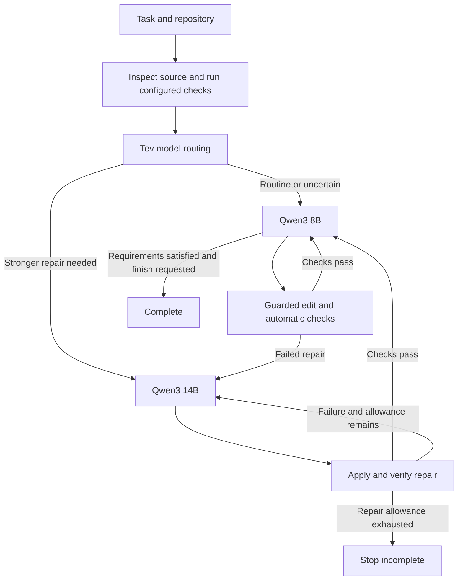

# PatchRook Agent

**A local coding harness for CPU-only laptops with 16 GB RAM.**

PatchRook Agent investigates code, applies guarded edits, and verifies changes using local models served through Ollama.

Developed and tested on a **CPU-only laptop with 16 GB RAM**, the project explores how better agent engineering can make constrained hardware more useful for software development. Its focus is the harness around the models: context selection, tools, verification, recovery, and selective escalation. No cloud API key is required.

## Overview

PatchRook combines three models with distinct responsibilities:

| Model | Role |
|---|---|
| **Qwen3 8B** | Primary code investigation, editing, and task completion |
| **Tev1 4B** | Initial model-routing decisions |
| **Qwen3 14B** | Focused repairs when stronger assistance is needed |

Tev selects the initial coding model. The harness then manages execution, detects failed repairs, and enforces editing and verification rules.

When work escalates to 14B, the repair receives current source and observed failure evidence. It has **up to two repair calls**. Passing the configured checks returns control to 8B; exhausting the allowance stops the task as incomplete.

## Designed around hardware constraints

- **Serial model management:** Loads and unloads models between phases to limit simultaneous memory use.
- **Selective context:** Supplies relevant source and failure evidence within a bounded context window.
- **Guarded editing:** Checks workspace boundaries and source matches, syntax-checks Python changes, and rejects ineffective edits.
- **Automatic verification:** Runs configured project checks after accepted edits and requires passing checks before completion.
- **Resumable sessions:** Preserves task state, observations, and checkpoints across interruptions.

The goal is to improve coding-task completion through a stronger execution harness while working within the limits of an ordinary laptop.

CPU inference can take several minutes per call. GPU acceleration is optional. Memory use, model-call budgets, and verification are explicit parts of the design.

## How it works



The default fix mode requires source inspection, an accepted change, and passing configured checks before completion.

## Installation

### Requirements

- **Python 3.11+**
- **Git**
- **ripgrep** (`rg`)
- **Ollama 0.35+**, including its native [decision-model endpoint](https://ollama.com/library/tev1)

On Ubuntu 24.04+ or Debian 12+:

```bash
sudo apt-get update
sudo apt-get install -y git python3 python3-venv python3-pip ripgrep curl
curl -fsSL https://ollama.com/install.sh | sh
```

On macOS, install Python, Git, and ripgrep with `brew install python git ripgrep`, then install and open [Ollama](https://ollama.com/download). See the official [Linux](https://docs.ollama.com/linux) and [macOS](https://docs.ollama.com/macos) instructions for platform details.

### Set up PatchRook Agent

Ensure Ollama is running. If it is not already running, start it in another terminal:

```bash
ollama serve
```

Then install PatchRook:

```bash
git clone https://github.com/YasinIsse/patchrook-agent.git
cd patchrook-agent
bash scripts/setup.sh
source .venv/bin/activate
```

Setup checks the prerequisites, creates `.venv`, installs the harness and test dependencies, and downloads:

```text
qwen3:8b
tev1:4b
qwen3:14b
```

For Python installation only, use `bash scripts/setup.sh --skip-models`. Select another Python with `bash scripts/setup.sh --python python3.12` if needed.

## Run a task

Install your target project's dependencies first. With the PatchRook environment activated:

```bash
cd /path/to/your/project
patchrook-agent "Fix the failing tests"
```

The default verification command is `python -m pytest -q`, using the target project's `.venv` when available. Running a task authorizes file edits and execution of the configured checks with your user permissions.

Specify a repository and verification command explicitly:

```bash
patchrook-agent "Fix the parser" \
  --workspace /path/to/project \
  --check "python -m pytest -q tests/test_parser.py"
```

Other project checks work too:

```bash
patchrook-agent "Fix the failing tests" --check "npm test"
```

Repeat `--check` to configure multiple commands. Each check runs as a command without an implicit shell.

### Defaults and overrides

| Setting | Default |
|---|---|
| Coding / routing / repair models | Qwen3 8B / Tev1 4B / Qwen3 14B |
| Thinking | Off |
| Context / output limit | 8,192 / 1,024 tokens |
| Total coding-call limit | 12 |
| 14B repair-call limit | 2 |
| Task deadline | 3,600 seconds |
| Timeout per check | 120 seconds |

Common overrides:

```bash
patchrook-agent "Fix the failing tests" --model-routing off

patchrook-agent "Fix the failing tests" \
  --model qwen3:14b --model-routing off

patchrook-agent "Implement the change" \
  --max-steps 24 --deadline 7200
```

Use `patchrook-agent --help` for available options. Missing check dependencies or required models are reported before inference.

## Pilot evaluation

The pilot uses **ten selected Python bug-repair tasks**: five from [QuixBugs](https://github.com/jkoppel/QuixBugs) and five HumanEvalFix tasks from [HumanEvalPack](https://huggingface.co/datasets/bigcode/humanevalpack). The HumanEvalFix setup provides documentation and public examples, with official tests held out for grading.

The author reports a separate **ten-attempt PatchRook evaluation**, with one attempt per task, compared with the mini-SWE-agent baseline on the same task selection:

| System | Grader-passing tasks | Pass rate |
|---|---:|---:|
| [mini-SWE-agent](https://github.com/SWE-agent/mini-swe-agent) + Qwen3 8B | 4/10 | 40% |
| PatchRook Agent + Qwen3 8B / Tev1 / Qwen3 14B | **8/10** | **80%** |

> On a 10-task pilot drawn from QuixBugs and HumanEvalPack, our 8B/Tev/14B system doubled grader-passing task coverage—from 4/10 to 8/10—compared with mini-SWE-agent using Qwen 8B.

This is a **100% relative increase**, or **40 percentage points**, on the selected pilot tasks.

These are author-reported pilot results, not full-dataset benchmark scores or proof of general performance. The systems use different model configurations, and grader acceptance does not establish complete specification coverage.

## Sessions and recovery

Sessions are stored outside the target repository:

```text
~/.local/state/patchrook-agent/runs/
```

Resume a saved session with:

```bash
patchrook-agent --resume SESSION_ID
```

Resume restores the saved models, checks, task state, and remaining budgets. Changed source is re-inspected before further work.

## Development

The setup script installs the test dependencies. Run the offline regression suite with:

```bash
python -m pytest -q
```

Tests use scripted model responses and exercise edit guards, routing, verification, context handling, and session recovery. They do not download models or run live inference.

Build an installable wheel and source archive with:

```bash
python -m build
```

## Contributing

Bug reports and focused pull requests are welcome. Include the task description, model tags, relevant configuration, and the observed failure when reporting an issue.
